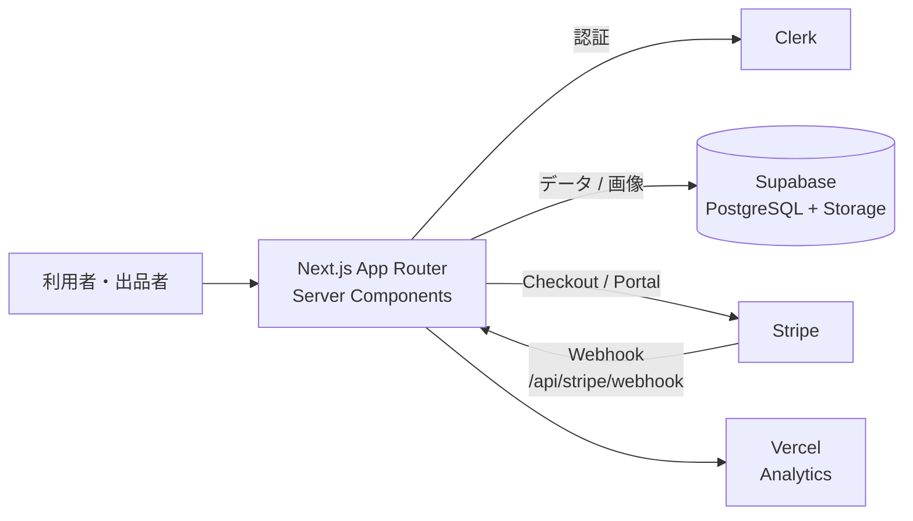

<div align="center">

# SaaSマーケット

**日本のSaaSを探せる・掲載できる、オープンソースのマーケットプレイス**

Next.js 14 (App Router) × Supabase × Clerk × Stripe でつくった、そのまま動くSaaSマーケットプレイスの実装です。

[](https://github.com/babushkai/saas-marketplace/actions/workflows/ci.yml)
[](LICENSE)


[](#コントリビュート)
[](https://github.com/babushkai/saas-marketplace/stargazers)

[**デモを見る**](https://saas-marketplace-zeta.vercel.app) ・ [セットアップ](#クイックスタート) ・ [コントリビュート](#コントリビュート)

</div>

---

## これは何？

日本発のSaaS・ツールを **カテゴリーや料金で探せて、出品者は無料で掲載できる** マーケットプレイスです。

アプリとして使えるだけでなく、次のような実装を **本番で動いているコード** として読めるのが特長です。

- Clerk 認証 × Supabase RLS の組み合わせ
- Stripe サブスクリプション（プラン別の掲載上限、Webhook、カスタマーポータル）
- App Router での SEO（動的OGP画像、sitemap、JSON-LD）
- 出品者ダッシュボード（閲覧数・問い合わせの分析）

「マーケットプレイス型のSaaSを作りたい」「Next.js 14 + Supabase の実例が見たい」という方の参考になればうれしいです。
役に立ったら ⭐ をもらえると励みになります。

## 主な機能

| 利用者向け | 出品者向け |
|---|---|
| カテゴリー・料金・キーワードでプロダクト検索 | プロダクトの登録・編集・公開切り替え |
| プロダクト詳細ページ（スクリーンショット、料金、出品者情報） | 問い合わせの受信・管理 |
| フォームから出品者へ直接問い合わせ | 閲覧数・問い合わせ数のアナリティクス |
| 出品者プロフィールページ | Stripe によるプラン管理（下表） |
| ブログ（SaaS比較・導入ガイド） | 画像アップロード（ロゴ・スクリーンショット） |

**出品プラン**（`lib/plans.ts`）

| プラン | 月額 | 掲載数 |
|---|---|---|
| フリー | 0円 | 3件まで |
| スタンダード | 980円 | 10件まで |
| プロ | 2,980円 | 無制限 |

## 技術スタック

| 領域 | 使用技術 |
|---|---|
| フレームワーク | [Next.js 14](https://nextjs.org/)（App Router）、React 18、TypeScript |
| スタイリング | [Tailwind CSS](https://tailwindcss.com/) |
| 認証 | [Clerk](https://clerk.com/)（日本語ローカライズ済み） |
| データベース | [Supabase](https://supabase.com/)（PostgreSQL + RLS + Storage） |
| 決済 | [Stripe](https://stripe.com/)（Checkout、Webhook、Customer Portal） |
| 計測 | Vercel Analytics / Speed Insights、Google Analytics |
| デプロイ | [Vercel](https://vercel.com/) |
| CI | GitHub Actions（lint、型チェック、ビルド） |

## アーキテクチャ



## クイックスタート

### 必要なもの

- Node.js 20 以上（CI と同じバージョン）
- [Clerk](https://dashboard.clerk.com)、[Supabase](https://supabase.com/dashboard) のアカウント（どちらも無料枠で動きます）
- 決済まで試す場合は [Stripe](https://dashboard.stripe.com) のテストモード

### 1. クローンとインストール

```bash
git clone https://github.com/babushkai/saas-marketplace.git
cd saas-marketplace
npm install
cp .env.example .env.local
```

### 2. 環境変数を設定

`.env.local` を編集します。

| 変数 | 取得元 |
|---|---|
| `NEXT_PUBLIC_CLERK_PUBLISHABLE_KEY` / `CLERK_SECRET_KEY` | Clerk ダッシュボード → API Keys |
| `NEXT_PUBLIC_SUPABASE_URL` / `NEXT_PUBLIC_SUPABASE_ANON_KEY` / `SUPABASE_SERVICE_ROLE_KEY` | Supabase → Project Settings → API |
| `STRIPE_SECRET_KEY` / `STRIPE_WEBHOOK_SECRET` | Stripe ダッシュボード（テストモード） |
| `STRIPE_PRICE_STANDARD` / `STRIPE_PRICE_PRO` | 手順4の `npm run setup:stripe` で生成 |
| `NEXT_PUBLIC_APP_URL` | ローカルなら `http://localhost:3000` |

> Clerk のキーが未設定でも、認証なしで画面の確認はできます。

### 3. データベースを作成

Supabase の SQL Editor で、次の順に実行します。

1. `supabase/schema.sql`（テーブル・RLS・インデックス）
2. `supabase/migrations/` 内のファイルを古い順に
3. `supabase/seed.sql`（任意：サンプルデータ）

画像アップロードを使う場合は、Storage に公開バケット `images` を作成してください。

### 4. Stripe の準備（任意）

```bash
npm run setup:stripe          # 商品と価格を作成し、Price ID を表示
stripe listen --forward-to localhost:3000/api/stripe/webhook   # ローカルで Webhook を受信
```

### 5. 起動

```bash
npm run dev
```

[http://localhost:3000](http://localhost:3000) を開けば完了です。

## スクリプト

| コマンド | 内容 |
|---|---|
| `npm run dev` | 開発サーバーを起動 |
| `npm run build` | 本番用ビルド |
| `npm run start` | 本番サーバーを起動 |
| `npm run lint` | ESLint |
| `npm run type-check` | TypeScript の型チェック |
| `npm run setup:stripe` | Stripe の商品・価格を作成 |

## ディレクトリ構成

```
├── app/
│   ├── api/            # API Routes（products, inquiries, stripe, upload など）
│   ├── dashboard/      # 出品者ダッシュボード
│   ├── products/       # 一覧・詳細ページ
│   ├── sellers/        # 出品者プロフィール
│   └── blog/           # ブログ
├── components/         # UI コンポーネント（layout, products, dashboard, ui）
├── lib/                # Supabase / Stripe クライアント、プラン定義、ユーティリティ
├── supabase/           # スキーマ、マイグレーション、シードデータ
├── scripts/            # セットアップ用スクリプト
└── types/              # 型定義
```

## コントリビュート

Issue・PR どちらも歓迎です。小さな修正（誤字、UI の改善、型の修正など）からでもお気軽にどうぞ。

1. リポジトリを Fork する
2. ブランチを作成する（`git checkout -b feat/your-feature`）
3. コミットする（[Conventional Commits](https://www.conventionalcommits.org/ja/) 形式：`feat:`、`fix:`、`docs:` など）
4. `npm run lint && npm run type-check` が通ることを確認する
5. Pull Request を作成する

バグ報告や機能の提案は [Issues](https://github.com/babushkai/saas-marketplace/issues) へ。

## ライセンス

[MIT License](LICENSE)：商用・非商用を問わず自由に使えます。

## 作者

**桑原大将（Daisuke Kuwahara）**：[@babushkai](https://github.com/babushkai)

---

<div align="center">

このリポジトリが役に立ったら ⭐ Star をお願いします！

</div>
